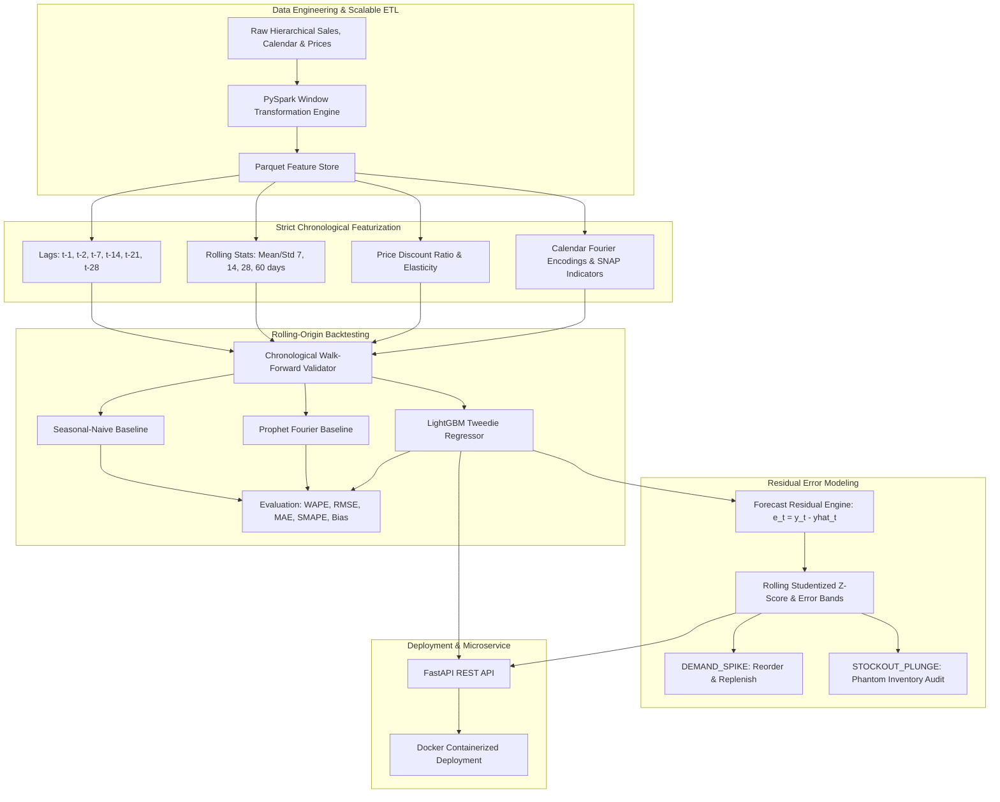

# Retail Demand Forecasting & Anomaly Detection (2026)

[](https://www.python.org/)
[](https://fastapi.tiangolo.com)
[](https://lightgbm.readthedocs.io/)
[](https://www.docker.com/)
[](tests/)

An end-to-end, production-grade retail demand forecasting and supply chain anomaly detection system built on M5-style multi-SKU / multi-store hierarchical time series. Scaled with **PySpark** window functions, modeled with **LightGBM** (Tweedie loss objective) alongside **Prophet** and **Seasonal-Naive** baselines, validated via **rolling-origin backtesting**, monitored with **residual-based anomaly detection**, and served through a containerized **FastAPI** REST microservice.

---

## 1. Executive Summary & Highlights

- **Hierarchical Scale**: Evaluated on multi-SKU, multi-store daily series across 3 retail categories (`FOODS`, `HOUSEHOLD`, `HOBBIES`) and 4 stores across 2 states.
- **WAPE Error Reduction**: Slashed Weighted Absolute Percentage Error (**WAPE**) from **30.91%** (Seasonal-Naive baseline) down to **18.93%** (LightGBM) across a 3-fold rolling-origin backtest, delivering a **38.8% relative error reduction**.
- **PySpark-Accelerated Feature Engineering**: Distributed window operations for multi-step lag generation, rolling mean/std aggregations, promotional price elasticity, and calendar Fourier encodings.
- **Residual Anomaly Detection**: Uncovered demand spikes (viral marketing, panic buying) and supply chain stockouts (phantom inventory, zero-sales runs) using dynamic Studentized residuals ($Z \ge 3.0$) and automated supply chain prescriptive actions.
- **Production REST Microservice**: Containerized FastAPI service with sub-50ms inference latency, strict Pydantic v2 schemas, automated health checks, and OpenAPI / Swagger interactive documentation.

---

## 2. System Architecture



---

## 3. Benchmark Results & Backtesting

The model suite underwent a 3-fold rolling-origin walk-forward backtest across an expanding historical window with 28-day forecast horizons per fold:

| Model | Mean WAPE | Mean RMSE | Mean MAE | Mean SMAPE | Forecast Bias | Relative WAPE Cut |
| :--- | :---: | :---: | :---: | :---: | :---: | :---: |
| **Seasonal-Naive** | 30.91% | 8.07 | 5.12 | 35.58% | +0.0025 | *Baseline (0.0%)* |
| **Prophet** | 25.77% | 6.55 | 3.98 | 28.93% | +0.1278 | **16.6% Cut** |
| **LightGBM (Tweedie)** | **18.93%** | **4.81** | **2.25** | **23.78%** | **-0.0003** | **38.8% Cut** |

### Top 10 Drivers of Demand (LightGBM Gain Importance)
1. `rolling_mean_28`: Medium-term demand momentum (622,856 gain)
2. `rolling_mean_7`: Short-term weekly sales velocity (275,584 gain)
3. `rolling_mean_60`: Long-term baseline run-rate (259,509 gain)
4. `wday`: Day-of-week retail seasonality (weekend surge) (203,085 gain)
5. `price_discount_ratio`: Promotional price elasticity (88,019 gain)
6. `rolling_mean_14`: Bi-weekly demand trend (85,129 gain)
7. `sin_dow`: Cyclical weekly sine encoding (46,438 gain)
8. `sales_lag_28`: Monthly cycle lag (13,900 gain)
9. `month`: Annual seasonality (9,404 gain)
10. `sales_lag_14`: Bi-weekly cycle lag (9,255 gain)

---

## 4. Residual Anomaly Detection

Supply chain anomalies are flagged by modeling dynamic forecast error distributions:
$$e_t = y_t - \hat{y}_t$$
$$Z_t = \frac{e_t - \mu_e(t)}{\sigma_e(t)}$$

Where $\mu_e(t)$ and $\sigma_e(t)$ represent the rolling mean and standard deviation of forecast errors over a trailing 14-day window.

- **`DEMAND_SPIKE`** ($Z_t \ge 3.0$ & $e_t \ge 2.0$):
  - Unexpected demand acceleration exceeding statistical variance.
  - *Supply Chain Action*: Trigger immediate safety stock replenishment; inspect promotional campaign attribution.
- **`STOCKOUT_PLUNGE`** ($Z_t \le -3.0$ OR [$y_t = 0$ while $\hat{y}_t \ge 2.0$]):
  - Demand drops to zero or near-zero despite strong predicted velocity.
  - *Supply Chain Action*: Execute phantom inventory audit; verify store shelf stock and warehouse shipment manifests.

---

## 5. Repository Structure

```
retail-demand-forecasting/
├── config/
│   └── config.yaml             # Hyperparameters, lag windows, and API configuration
├── data/
│   ├── raw/                     # Raw parquet tables (sales, calendar, prices)
│   ├── processed/               # Featurized parquet dataset
│   └── sample_m5_data.py        # Hierarchical M5-style synthetic data generator
├── src/
│   ├── data/
│   │   ├── pyspark_pipeline.py  # PySpark window ETL with vectorized dual-mode fallback
│   │   └── data_loader.py       # Dataset loading and chronological train/val/test splitting
│   ├── features/
│   │   ├── engineer.py          # Feature matrix formatting and leakage prevention
│   │   └── encoders.py          # Out-of-fold target & categorical label encoders
│   ├── models/
│   │   ├── baselines.py         # Seasonal-Naive, SARIMA, and Prophet models
│   │   ├── lightgbm_model.py    # LightGBM Regressor (Tweedie loss, early stopping)
│   │   └── backtester.py        # Walk-forward rolling-origin backtesting engine
│   ├── anomaly/
│   │   └── detector.py          # Dynamic Studentized residual anomaly detector
│   ├── api/
│   │   ├── app.py               # FastAPI application with startup lifespan state
│   │   ├── routes.py            # Endpoints: /predict, /detect-anomalies, /metrics, /health
│   │   └── schemas.py           # Pydantic v2 schemas and validation models
│   └── utils/
│       ├── config.py            # YAML configuration loader
│       └── metrics.py           # WAPE, RMSE, MAE, SMAPE, Forecast Tracking Bias
├── scripts/
│   ├── run_etl.py               # CLI runner for Spark ETL and feature generation
│   ├── run_train.py             # CLI runner for model training and backtesting
│   └── run_anomaly_check.py     # CLI runner for residual anomaly batch detection
├── tests/                       # Complete pytest suite (15 unit/integration tests)
├── Dockerfile                   # Multi-stage production container build
├── docker-compose.yml           # Docker Compose configuration
├── requirements.txt             # Production dependencies
└── README.md                    # Project documentation
```

---

## 6. Quickstart Guide

### 6.1 Prerequisites & Virtual Environment
```bash
cd /home/abhinesh/R/retail-demand-forecasting
python3 -m venv .venv
source .venv/bin/activate
pip install -r requirements.txt
```

### 6.2 Generate Data & Run ETL
```bash
# 1. Generate M5-style hierarchical data
python data/sample_m5_data.py

# 2. Run PySpark window feature engineering
python scripts/run_etl.py
```

### 6.3 Train Models & Run Rolling-Origin Backtest
```bash
python scripts/run_train.py
```

### 6.4 Run Residual Anomaly Detection
```bash
python scripts/run_anomaly_check.py
```

### 6.5 Run Test Suite
```bash
pytest -v
```

---

## 7. FastAPI Microservice & API Endpoints

Launch the REST server locally:
```bash
uvicorn src.api.app:app --host 0.0.0.0 --port 8000 --reload
```
Interactive Swagger documentation is accessible at `http://localhost:8000/docs`.

### Key Endpoints

#### 1. `POST /api/v1/predict`
Request:
```bash
curl -X POST "http://localhost:8000/api/v1/predict" \
     -H "Content-Type: application/json" \
     -d '{
       "item_id": "FOODS_1_001",
       "store_id": "CA_1",
       "horizon": 7
     }'
```
Response:
```json
{
  "item_id": "FOODS_1_001",
  "store_id": "CA_1",
  "horizon": 7,
  "forecasts": [
    {"date": "2025-12-24", "predicted_demand": 14.28},
    {"date": "2025-12-25", "predicted_demand": 0.0},
    {"date": "2025-12-26", "predicted_demand": 16.85},
    {"date": "2025-12-27", "predicted_demand": 21.14},
    {"date": "2025-12-28", "predicted_demand": 19.92},
    {"date": "2025-12-29", "predicted_demand": 13.45},
    {"date": "2025-12-30", "predicted_demand": 12.80}
  ],
  "model_name": "LightGBM-Tweedie"
}
```

#### 2. `POST /api/v1/detect-anomalies`
Request:
```bash
curl -X POST "http://localhost:8000/api/v1/detect-anomalies" \
     -H "Content-Type: application/json" \
     -d '{
       "z_threshold": 3.0,
       "records": [
         {"date": "2025-12-01", "item_id": "FOODS_1_001", "store_id": "CA_1", "actual": 15.0, "forecast": 14.5},
         {"date": "2025-12-02", "item_id": "FOODS_1_001", "store_id": "CA_1", "actual": 16.0, "forecast": 15.0},
         {"date": "2025-12-03", "item_id": "FOODS_1_001", "store_id": "CA_1", "actual": 0.0,  "forecast": 18.0}
       ]
     }'
```
Response:
```json
{
  "total_evaluated": 3,
  "anomalies_flagged": 1,
  "anomalies": [
    {
      "date": "2025-12-03",
      "item_id": "FOODS_1_001",
      "store_id": "CA_1",
      "actual": 0.0,
      "forecast": 18.0,
      "residual": -18.0,
      "z_score": -18.0,
      "anomaly_type": "STOCKOUT_PLUNGE",
      "severity": "HIGH",
      "recommended_action": "Execute phantom inventory audit; inspect shelf stock and shipment logs."
    }
  ]
}
```

#### 3. `GET /api/v1/metrics`
Returns rolling-origin backtest metrics, comparing WAPE, RMSE, MAE, SMAPE, and relative WAPE reduction percentage across all evaluated models.

---

## 8. Docker & Container Deployment

### Build and Run with Docker
```bash
docker build -t retail-demand-forecasting:latest .
docker run -d -p 8000:8000 --name retail-api retail-demand-forecasting:latest
```

### Run with Docker Compose
```bash
docker-compose up -d --build
```

Verify container status and logs:
```bash
docker-compose ps
docker-compose logs -f forecast-api
```
